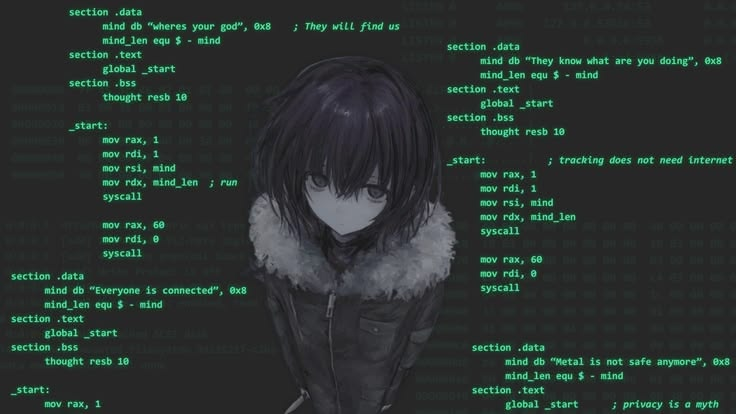

  <strong>Salut! je suis Joyce ૮₍˶ᵔ ᵕ ᵔ˶₎ა </strong>

---

  <table>
    <tr>
      <td>
        
      </td>
      <td>
        
      </td>
    </tr>
  </table>

<h3>Computer security researcher / red team</h3>

computer security researcher / red team

 

I am a computer science enthusiast who enjoys studying and understanding how software works.
I analyze code and fix flaws that compromise optimization or execution security.

I am a student of computer security and offensive security research. My goal is to understand where and how systems fail, in parts like the web application, kernel and firmware:

My base is low level: reverse engineering of binaries and operating systems, malware analysis and firmware study. Knowing the inner workings of the kernel (Linux and Windows NT), syscalls, permissions and tokens model and the TCP/IP stack allows me to understand why a technique works, and not just how to execute it.

On the web, I use OWASP WSTG as a testing methodology and study attacks that start with weaknesses and become paths to vulnerabilities, how to mitigate them and how firewalls and WAFs detect or miss them. I usually track the problem through all layers, from the network packet to the application logic.

I use AI to accelerate code analysis, automate tests and write scripts, always validating the result. I also research attacks against AI agents, such as prompt injection, tool abuse and malicious code execution, and ways to mitigate them.
